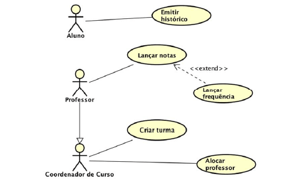
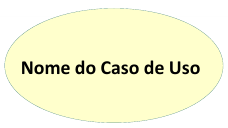
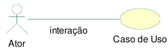
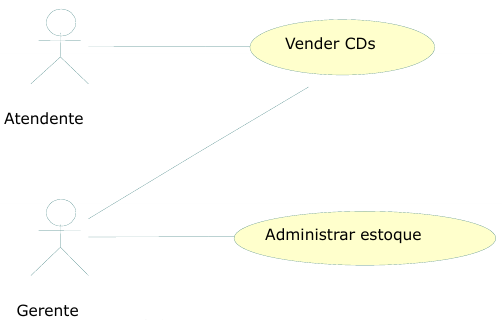
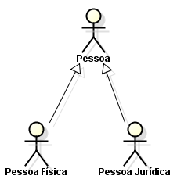
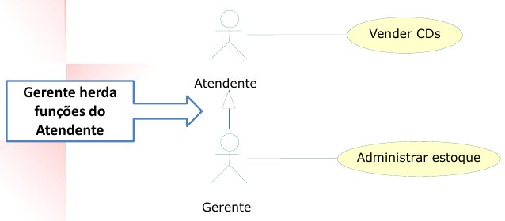
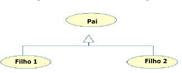
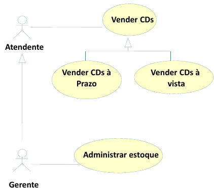
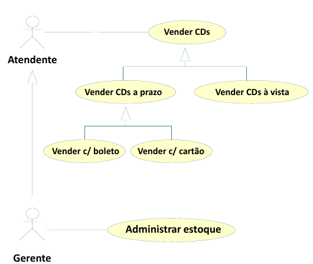
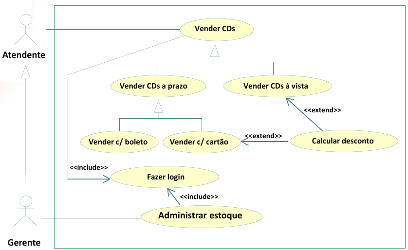

# Projeto Integrador - Modelo
*Lumena*

Projeto Integrador do Curso de Técnico em Desenvolvimento de Sistemas para a Internet Integrado ao Ensino Médio do IFC - Campus Araquari.

*Nosso projeto visa o desenvolvimento de uma aplicação WEB, com o objetivo de ampliar o reconhecimento de uma microempreendedora no ramo de velas aromáticas artesanais, oferecendo uma plataforma com funcionalidades para otimização da venda de seus produtos. Além disso, possibilita uma relação personalizada de cliente e vendedor, por meio da escolha de produtos, seleção de aromas, visualização de detalhes e finalização de compra de forma prática com um mapa de geolocalização para endereços e envio de mensagens diretamente para  vendedora.*

Professor: [Marco André Mendes](github.com/marcoandre)

Equipe:
- [Amanda Ribeiro da Luz](https://github.com/AmandaRibeiroLuz)
- [Heloisa de Farias Longhi](https://github.com/HeloLonghi)

Links do projeto:
-   [Documentação (esse documento)](https://github.com/Projeto-Lumena/Documentacao)
-   Backend: [Repositório](https://github.com/Projeto-Lumena/Backend) e [Publicação](https://backend-lumena.class.fabricadesoftware.ifc.edu.br/)
-   Frontend: [Repositório](https://github.com/Projeto-Lumena/Frontend) e [Publicação](https://frontend-lumena-mu.vercel.app/)

# 1. Desenvolvimento

**1.1.1 Ponto de Vendas (PDV)**

Um sistema de ponto de vendas é um software que permite a um estabelecimento comercial registrar as vendas realizadas, gerenciar o estoque, emitir notas fiscais, etc. Ele é utilizado principalmente em lojas, supermercados, padarias, restaurantes, etc.

**Loja de aromas Lumena:**

A nossa cliente, Lorena, possui uma marca de produção de velas aromáticas, chamada Lumena e, devido à baixa divulgação de seus produtos, será desenvolvido um sistema que auxilie na divulgação e otimize suas vendas. Para isso, o sistema contará com os produtos que podem ser cadastrados por ela e permitirá ao usuário o acesso e visualização aos produtos e finalização de compras. O sistema também permitirá o registro e controle das vendas realizadas, aproximando-se das funcionalidades de um sistema de ponto de vendas. Portanto, o motivo da escolha do modelo de ponto de vendas deve-se ao fato da necessidade da cliente ampliar o alcance da venda de seus produtos.

# 2. Situação Problema

A empresa Lumena produz de maneira artesanal velas aromáticas desde o início de 2025. A dona da empresa, Lorena, possui formação técnica em farmácia e trabalha individualmente na produção das velas. A empresa disponibiliza as seguintes opções de aroma: Baunilha, Bergamota, Canela e Maçã, Capim Limão, Flor de Cerejeira, Flor de Laranjeira, Jasmim, Lavanda Francesa e Limão Siciliano. Sendo possível a escolha de tamanhos do P, M e G.

Atualmente, a empresa Lumena realiza suas vendas principalmente por meio das redes sociais, como Instagram e WhatsApp. Os clientes entram em contato diretamente com a dona, para solicitar informações sobre os produtos, escolher aromas, tamanhos e realizar pedidos personalizados.

Após o contato inicial, Lorena deixa salvo o pedido no contato do cliente. Não há um sistema digital para organizar esses dados, o que pode dificultar a visualização e o controle dos pedidos em andamento.

A produção das velas é feita de forma artesanal pela própria Lorena, que organiza sua rotina de acordo com a demanda de pedidos registrados. Como não existe um controle automatizado, a gestão é feita de maneira visual ou por estimativa.

Além disso, o controle financeiro também é realizado manualmente. Os pagamentos são feitos via Pix ou dinheiro, e as informações são anotadas separadamente, sem integração com os pedidos realizados. Isso dificulta a organização e o acompanhamento do faturamento da empresa.

Diante dessa situação, é possível identificar dificuldades na organização dos pedidos, no controle e na gestão da empresa. A ausência de um sistema informatizado pode causar erros, retrabalho e perda de informações. Dessa forma, o desenvolvimento de um software de vendas poderia otimizar os processos, melhorar a organização e contribuir para o crescimento da empresa Lumena.

# 3. Descrição da proposta

A proposta do sistema Lumena é o desenvolvimento de uma aplicação que potencialize a divulgação, gerenciamento e venda de velas aromáticas artesanais. O principal objetivo do sistema é possibilitar que a dona do empreendimento amplie o alcance de sua marca, organize seus produtos e otimize o processo de venda e compra, trazendo uma solução para as atuais dificuldades em relação à baixa visibilidade dos produtos e mal gerenciamento das vendas.

Os clientes, poderão acessar o sistema e visualizar os produtos cadastrados, ler detalhes, escolher o produto, aroma e demais informações para fazer o seu pedido e finalizar a compra de forma segura.

Portanto, o sistema deverá permitir a divulgação organizada e atrativa dos produtos, permitindo uma experiência confortável para o cliente e eficiente para a vendedora. Desse modo, a proposta busca, além de facilitar e otimizar as vendas, aumentar a presença digital da marca, fortalecendo e contribuindo para o crescimento do negócio.

# 4. Modelagem de Dados

.

# 5. Regras de negócio

- **RN01 – Listagem de Produtos:** O sistema deve apresentar os produtos cadastrados no catálogo, exibindo suas imagens, nomes e preços.
- **RN02 – Detalhes do Produto:** O cliente deve poder acessar os detalhes de um produto para consultar sua imagem, descrição, tamanhos disponíveis e respectivos preços.
- **RN03 – Busca de Produtos:** O sistema deve permitir que o cliente pesquise produtos pelo nome e visualize os resultados correspondentes.
- **RN04 – Consulta aos Aromas:** O sistema deve disponibilizar informações sobre os aromas das velas para que o cliente possa conhecer suas características.
- **RN05 – Seleção de Tamanho:** Para adicionar uma vela à sacola, o cliente deve selecionar uma das opções de tamanho disponíveis para o produto.
- **RN06 – Preço por Variação:** O preço considerado para cada vela deve corresponder ao tamanho selecionado pelo cliente.
- **RN07 – Adição de Produtos à Sacola:** O sistema deve permitir que o cliente adicione produtos à sacola, registrando o produto selecionado, seu tamanho, preço e quantidade.
- **RN08 – Alteração da Quantidade:** O cliente deve poder aumentar ou diminuir a quantidade dos produtos na sacola, com atualização dos valores correspondentes.
- **RN09 – Remoção de Produtos:** O sistema deve permitir que o cliente remova produtos da sacola e atualize os valores apresentados após a remoção.
- **RN10 – Cálculo do Subtotal:** O sistema deve calcular o subtotal dos produtos da sacola considerando o preço de cada item e sua respectiva quantidade.
- **RN11 – Cálculo do Frete:** O sistema deve calcular o valor do frete com base na distância entre a origem e o endereço informado pelo cliente, utilizando a tarifa de R$ 2,00 por quilômetro.
- **RN12 – Informações de Endereço:** O sistema deve permitir que o cliente informe seu endereço para o cálculo do frete, utilizando os recursos de localização disponíveis.
- **RN13 – Visualização da Localização:** O sistema deve apresentar um mapa para auxiliar na visualização da localização utilizada no processo de compra.
- **RN14 – Cálculo do Valor Total:** O sistema deve apresentar o valor total da compra considerando o subtotal dos produtos e o valor do frete.
- **RN15 – Contato com a Vendedora:** O sistema deve permitir que o cliente entre em contato com a vendedora pelo WhatsApp, utilizando uma mensagem preparada com as informações pertinentes ao pedido.
- **RN16 – Sacola Vazia:** Quando não houver produtos adicionados, o sistema deve apresentar a sacola vazia, sem exibir itens ou valores.

# 6. Requisitos funcionais

**Entradas:**

- **R.F. 01 - Cadastro de usuário**:
Permitir que novos clientes realizem seu cadastro na plataforma para acessar o sistema, visualizar produtos e efetuar pedidos.
  - **Dados necessários:** nome, email, telefone, senha, data_nascimento, foto_perfil.
  - **Usuários:** Cliente.
- **R.F. 02 - Gerenciamento de produto**:
Permitir que a administradora cadastre, edite e exclua produtos do sistema, incluindo suas informações.
  - **Dados necessários:** nome, descricao, preco, ativo, imagem.
  - **Usuários:** Administradora.
- **R.F. 03 - Cadastro de categoria**:
Permitir que a administradora cadastre categorias para organizar os produtos no sistema.
  - **Dados necessários:** nome, descricao.
  - **Usuários:** Administradora.
- **R.F. 04 - Edição do perfil**:
Permitir que o usuário atualize seus dados pessoais e de contato cadastrados no sistema.
  - **Dados necessários:** nome, telefone, email, senha, foto_perfil.
  - **Usuários:** Cliente.

**Processos:**

- **R.F. 05 - Autenticação de usuário**:
Permitir que usuários cadastrados realizem login no sistema para acessar suas funcionalidades, efetuar e visualizar seus pedidos.
  - **Dados necessários:** email, senha.
  - **Usuários:** Cliente, Administradora.
- **R.F. 06 - Registro de pedido**:
Permitir que o cliente finalize a compra dos produtos selecionados, gerando um pedido no sistema.
  - **Dados necessários:** id_usuario, data_pedido, valor_total, status.
  - **Usuários:** Cliente.
- **R.F. 07 - Registro do item do pedido**:
Permitir a inclusão de produtos em um pedido, definindo quantidade e calculando automaticamente o subtotal.
  - **Dados necessários:** id_pedido, id_produto, quantidade, preco_unitario, subtotal.
  - **Usuários:** Cliente.
- **R.F. 08 - Registro de pagamento**:
Permitir o registro do pagamento de um pedido realizado.
  - **Dados necessários:** id_pedido, valor, status, data_pagamento, metodo.
  - **Usuários:** Cliente, Administradora.
- **R.F. 09 - Gerenciamento de pedidos**:
Permitir que a administradora visualize e atualize o status dos pedidos realizados no sistema.
  - **Dados necessários:** id_pedido, status, data_entrega.
  - **Usuários:** Administradora.
- **R.F. 10 - Gerenciamento de itens do pedido**:
Permitir que o cliente adicione produtos ao pedido, altere quantidades, remova itens e prossiga para finalização do pedido. 
  - **Dados necessários:** id_produto, quantidade, preco.
  - **Usuários:** Cliente.
- **R.F. 11 - Cancelamento de pedido**:
Permitir que o cliente solicite o cancelamento de um pedido que ainda não foi pago.
  - **Dados necessários:** id_pedido, status.
  - **Usuários:** Cliente.
- **R.F. 12 - Filtragem de produtos**:
Permitir que o cliente filtre os produtos por categoria e relevância.
  - **Dados necessários:** categoria.
  - **Usuários:** Cliente.

**Saídas:**

- **R.F. 13 - Visualização de produtos**:
Permitir que os clientes visualizem os produtos disponíveis na loja com suas informações detalhadas.
  - **Dados necessários:** nome, descricao, preco, categoria, imagem.
  - **Usuários:** Cliente.
- **R.F. 14 - Visualização de pedidos**:
Permitir que o usuário visualize o histórico de pedidos realizados no sistema.
  - **Dados necessários:** data_pedido, status, valor_total, data_entrega.
  - **Usuários:** Cliente, Administradora.
- **R.F. 15 - Visualização de clientes cadastrados**:
Permitir que a administradora visualize a lista de clientes cadastrados no sistema para eventuais contatos ou suporte.
  - **Dados necessários:** nome, email, telefone, data_nascimento.
  - **Usuários:** Administradora.

# 7. Requisitos não funcionais

- **R.N.F. 01 – Tecnologia Front-end:** O sistema deverá utilizar Vue.js para a construção da interface, Tailwind CSS para a estilização, Pinia para o gerenciamento de estado, Vue Router para a navegação entre páginas e Axios para as requisições HTTP.
- **R.N.F. 02 – Tecnologia Back-end:** O backend deverá utilizar Python, Django e Django REST Framework para disponibilizar os recursos da aplicação por meio de uma API.
- **R.N.F. 03 – Arquitetura da aplicação:** O sistema deverá manter a separação entre frontend e backend, permitindo que a interface se comunique com os serviços disponibilizados pela API.
- **R.N.F. 04 – Aplicação Web:** O sistema deverá ser disponibilizado pela internet, permitindo o acesso dos clientes por meio de um navegador.
- **R.N.F. 05 – Compatibilidade com navegadores:** A aplicação deverá ser compatível com navegadores modernos que ofereçam suporte às tecnologias utilizadas no desenvolvimento do sistema.
- **R.N.F. 06 – Usabilidade:** A interface deverá apresentar os produtos, suas informações e as opções de compra de maneira clara e organizada, facilitando a navegação e a utilização das funcionalidades pelos clientes.
- **R.N.F. 07 – Responsividade:** A interface deverá adaptar sua apresentação a diferentes tamanhos de tela, permitindo a utilização em computadores, tablets e dispositivos móveis.
- **R.N.F. 08 – Tecnologia PWA:** O frontend deverá utilizar os recursos de Progressive Web App (PWA) implementados no projeto, possibilitando os recursos de instalação e outras funcionalidades compatíveis com a configuração adotada.
- **R.N.F. 09 – Segurança na comunicação:** A aplicação publicada deverá utilizar HTTPS para proteger a comunicação entre o navegador do cliente e os servidores, conforme a configuração dos ambientes de hospedagem.
- **R.N.F. 10 – Proteção de dados pessoais:** Caso sejam coletados ou processados dados pessoais dos clientes, o sistema deverá observar os princípios e as exigências aplicáveis da Lei Geral de Proteção de Dados Pessoais (LGPD).
- **R.N.F. 11 – Hospedagem:** O frontend deverá ser disponibilizado por meio da plataforma Vercel, enquanto o backend deverá utilizar o ambiente do Fabroku.
- **R.N.F. 12 – Identidade visual:** A interface deverá manter a identidade visual da marca Lumena, utilizando a paleta de cores, a tipografia e os elementos visuais definidos para o projeto.

# 8. Diagrama de Caso de Uso

**8.1 Introdução**

O diagrama de caso de uso é uma ferramenta de modelagem que descreve o comportamento de um sistema a partir da perspectiva do usuário. Ele é usado para capturar os requisitos funcionais de um sistema.

- Especificam a visão externa do sistema.
- Descrevem como o sistema é percebido por seus usuários.
- Descrevem as interações entre os usuários e o sistema.

**Os casos de uso:**
- Descrevem como os **usuários interagem com o sistema** (as funcionalidades do sistema)
- Facilitam a **organização dos requisitos** de um sistema.
- Dão uma **visão externa** do sistema
- O conjunto de casos de uso deve ser capaz de comunicar a **funcionalidade** e o **comportamento** do sistema para o cliente.
- Descrevem **o que** o sistema faz, mas **não** especificam **como** isso deve ser feito.

**8.2 Elementos do diagrama de caso de uso**

8.2.1 **Atores**

- Representam os papéis desempenhados por **elementos externos** ao sistema
  - Ex: humano (usuário), dispositivo de hardware ou outro sistema (cliente)
- Elementos que **interagem** com o sistema

Notação:

**Exemplo: Loja de CDs**

**Identificando os atores**
- Uma loja de CDs possui discos para venda. Um cliente pode comprar uma quantidade ilimitada de discos para isto ele deve se dirigir à loja.
- A loja possui um **atendente** cuja função é atender os clientes durante a venda dos discos. A loja também possui um **gerente** cuja função é administrar o estoque para que não faltem discos. Além disso é ele quem dá folga ao atendente, ou seja, ele também atende os clientes durante a venda dos discos.

**E o cliente?**
- Não é ator pois ele **não interage** com o sistema!

**8.2.2 Casos de uso**

- Representam **funcionalidades** do sistema (requisitos funcionais).
- São iniciados por **atores** ou por outros casos de uso.

> **Dica**: nomeie os casos de uso com **verbos** no **infinitivo**.

Notação:

**Exemplo: Loja de CDs**

**Identificando os casos de uso**

- Uma loja de CDs possui discos para venda. Um cliente pode comprar uma quantidade ilimitada de discos para isto ele deve se dirigir à loja. A loja possui um atendente cuja função é atender os clientes durante a **venda dos discos**.
- A loja também possui um gerente cuja função é **administrar o estoque** para que não faltem discos. Além disso é ele quem dá folga ao atendente, ou seja, ele também atende os clientes durante a **venda dos discos**.

**8.2.3 Relacionamentos**

**8.2.3.1 Relacionamento de associação**

- Indica que um ator **participa** de um caso de uso, ou seja, o ator **interage** (comunica-se) com o caso de uso.
- É representado por uma **linha sólida**.
- Um ator pode se relacionar com **um ou mais casos de uso**.

> Dicas:
> - Não use setas nas linhas de associação.
> - Associações não representam fluxo de informação.

**Exemplo: Loja de CDs**

**Identificando os relacionamentos de associação**

- Uma loja de CDs possui discos para venda. Um cliente pode comprar uma quantidade ilimitada de discos para isto ele deve se dirigir à loja. A loja possui um _atendente_ cuja função é atender os clientes durante a **venda dos discos**.
- A loja também possui um _gerente_ cuja função é **administrar o estoque** para que não faltem discos. Além disso é ele quem dá folga ao _atendente_, ou seja, ele também atende os clientes durante a **venda dos discos**.

**8.2.3.2 Relacionamento de generalização/especialização**

**Generalização de atores**

- Quando dois ou mais atores podem se **comunicar com o mesmo conjunto de casos de uso**.
- Indica que um ator **herda** as características de outro ator.
– Um filho (herdeiro) pode se comunicar com todos os casos de uso que seu pai se comunica.

> **Dica:** coloque os herdeiros **embaixo**.

**Notação:**

**Exemplo: Loja de CDs**

**Identificando os relacionamentos de generalização/especialização de atores**

**Generalização de casos de uso**

– O caso de uso filho herda o comportamento e o significado do caso de uso pai.
– O caso de uso filho pode incluir ou sobrescrever o comportamento do caso de uso pai.
– O caso de uso filho pode substituir o caso de uso pai em qualquer lugar que ele apareça.

> **Dica:** deve ser aplicada quando uma condição resulta na definição de
diversos fluxos alternativos.

Notação:

**Exemplo: Loja de CDs**

**Identificando os relacionamentos de generalização/especialização de casos de uso**

**Novos requisitos:**

- As vendas podem ser **à vista** ou **a prazo**. Em ambos os casos o estoque é
atualizado e uma nota fiscal, entregue ao consumidor.
- No caso de uma **venda à vista**, clientes cadastrados na loja e que compram mais de 5 CDs de uma só vez ganham um desconto de 1% para cada ano de cadastro.
- No caso de uma **venda a prazo**, ela pode ser parcelada em 2 pagamentos com um
acréscimo de 20%. As vendas a prazo podem ser pagas no **cartão** ou no **boleto**.
  - Para pagamento com **boleto**, são gerados boletos bancários que são entregues ao cliente e armazenados no sistema para lançamento posterior no caixa.
  - Para pagamento com **cartão**, os clientes com mais de 10 anos de cadastro na loja ganham o mesmo desconto das compras à vista.

**Identificando mais relacionamentos de generalização/especialização de casos de uso**

**8.2.3.3 Relacionamento de dependência**

**Extensão**

- Representa uma variação/extensão do comportamento do caso de uso base.
- O caso de uso estendido só é executado sob certas circunstâncias.
- Separa partes obrigatórias de partes opcionais.
  - Partes obrigatórias: caso de uso base.
  - Partes opcionais: caso de uso estendido.
- Fatorar comportamentos variantes do sistema (podendo reusar este comportamento
em outros casos de uso).

**Notação:**

 - notação")

**Exemplo: Loja de CDs**

**Identificando os relacionamentos de dependência (extensão)**

**Novos requisitos:**
- No caso de uma venda à vista, clientes cadastrados na loja e que compram mais
de 5 CDs de uma só vez ganham um **desconto** de 1% para cada ano de cadastro.
- No caso de uma venda a prazo...
  - ...Para pagamento com cartão, os clientes com mais de 10 anos de cadastro na loja ganham o mesmo **desconto** das compras à vista.

")

**Inclusão**

- Evita repetição ao fatorar uma atividade
comum a dois ou mais casos de uso.
- Um caso de uso pode incluir vários casos de uso.

**Notação:**

 - notação")

**Exemplo: Loja de CDs**

**Novos requisitos:**
Para efetuar vendas ou administrar estoque, atendentes e gerentes terão que **validar** suas respectivas senhas de
acesso ao sistema.

")

**8.2.4 Fronteira do sistema**

- Elemento opcional (mas essencial para um bom
entendimento).
- Serve para definir a área de atuação do sistema, ou seja, seus limites.

**Identificando a fronteira do sistema**

---

